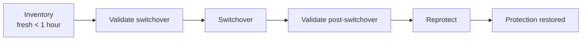
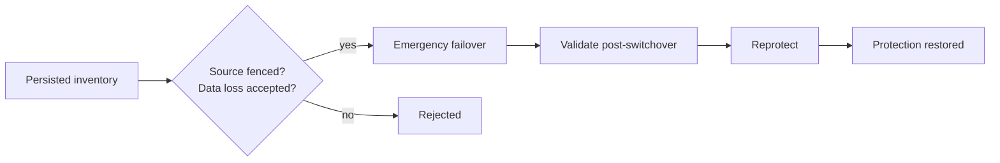
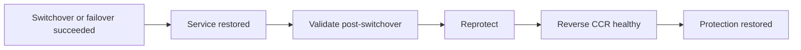

# Recovery paths

These diagrams show the command order enforced by the durable workflow ledger.
The controller records every completed operation and exposes the requirements
in the dashboard.

## Planned switchover

A planned switchover begins from a stable protected state. The inventory must
be fresh (less than one hour), and validation must refer to that same inventory.

`Switchover` blocks writes on the former primary, waits for CCR convergence,
promotes the target, and leaves reverse protection pending until `Reprotect`
completes.

## Emergency failover

Failover is for a primary outage. It does not require a new inventory or the
planned validation, because the primary might be unreachable. It does require
persisted inventory evidence, explicit source fencing, and explicit acceptance
of potential data loss.

When the saved inventory is older than one hour, the operator must also confirm
follower annotations before promotion.

## Shared recovery

Both recovery paths converge only after service has been restored. This common
sequence validates the promoted service before recreating reverse CCR.

The workflow resets for a new recovery cycle after the configured display delay
once protection has been restored.
